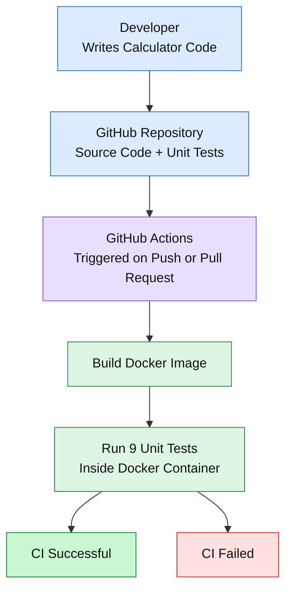

# Calculator CI Architecture

## Architecture Diagram

## Workflow Explanation

1. **Developer:** Writes or modifies the calculator code.
2. **GitHub Repository:** Stores the calculator, unit tests, and Docker configuration.
3. **GitHub Actions:** Automatically starts the CI workflow on configured pushes and pull requests.
4. **Build Docker Image:** Packages the application, Python runtime, and dependencies.
5. **Run Unit Tests:** Executes all 9 tests inside the Docker container.
6. **CI Result:** Reports success when the tests pass or failure when the build or tests fail.

## Scope

This diagram represents the implemented CI pipeline.